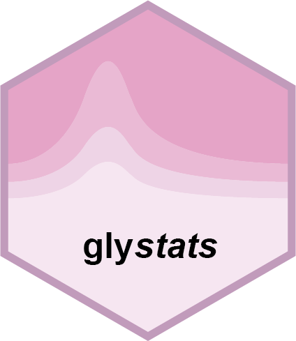

<!-- README.md is generated from README.Rmd. Please edit that file -->

# glystats <a href="https://glycoverse.github.io/glystats/"></a>

<!-- badges: start -->

[](https://lifecycle.r-lib.org/articles/stages.html#experimental)
[](https://glycoverse.r-universe.dev/glystats)
[](https://github.com/glycoverse/glystats/actions/workflows/R-CMD-check.yaml)
[](https://app.codecov.io/gh/glycoverse/glystats)
<!-- badges: end -->

The goal of glystats is to perform statistical analysis on
glycoproteomics and glycomics data. It works seamlessly with the
[glyexp](https://github.com/glycoverse/glyexp) package.

## Installation

### Install glycoverse

We recommend installing the meta-package
[glycoverse](https://github.com/glycoverse/glycoverse), which includes
this package and other core glycoverse packages.

### Install glystats alone

If you don’t want to install all glycoverse packages, you can only
install glystats.

You can install the latest release of glystats from
[r-universe](https://glycoverse.r-universe.dev/glystats)
(**recommended**):

``` r
# install.packages("pak")
pak::repo_add(glycoverse = "https://glycoverse.r-universe.dev")
pak::pkg_install("glystats")
```

Or from [GitHub](https://github.com/glycoverse/glystats):

``` r
pak::pkg_install("glycoverse/glystats@*release")
```

Or install the development version (NOT recommended):

``` r
pak::pkg_install("glycoverse/glystats")
```

**Note:** Tips and troubleshooting for the meta-package
[glycoverse](https://github.com/glycoverse/glycoverse) are also
applicable here: [Installation of
glycoverse](https://github.com/glycoverse/glycoverse#installation).

## Control log transformation

All expression-analysis functions default to `log_transform = NULL`.
Record the supplied abundance scale in `S4Vectors::metadata(exp)$scale`:
`"raw"`, `"log"` (natural logarithm), `"log2"`, or `"log10"`. Known
logged values are used unchanged. Raw values and old objects without
scale metadata retain each method’s previous default; Cox, ROC, and fold
change continue to use unlogged values by default. Use `TRUE` to force
the method’s log transformation or `FALSE` to use supplied values
unchanged. Setting metadata never transforms the data.

``` r
# Data already transformed using log10:
S4Vectors::metadata(exp)$scale <- "log10"
pca <- gly_pca(exp)
pca$preprocessing
# Explicitly opt in for Cox's log2(x + 1e-6) transformation:
cox <- gly_cox(exp, log_transform = TRUE)
```

PCA, PLS-DA, OPLS-DA, t-SNE, and UMAP retain `log(x + 1)`; other methods
use `log2(x + 1e-6)` when enabled. Set construction and inference share
the same choice. Results retain input metadata in `meta_data` and record
input/analysis scales and the actual transformation in `preprocessing`.
Model estimates, standard errors, intervals, and raw fits stay in
analysis units.

For raw inputs, differential-test fold changes remain log2 ratios of
arithmetic means. For logged inputs, they are differences of group means
converted to log2 units (geometric mean ratios). Natural-log differences
are divided by `log(2)`; base-10 differences are multiplied by
`log2(10)`. Limma contrasts follow the same change of base; raw-scale
contrasts are returned as `estimate` with `NA` `log2fc`.
`gly_fold_change(log_transform = TRUE)` uses newly logged values,
including the original pseudo-count. See `?gly_scale` for the full
contract.

Older development objects labeled `"log"` must be relabeled if their
actual base was 2 or 10. The package never guesses the base. Result
extraction and significance-filtering utilities do not transform
expression.

## Documentation

-   🚀 Get started:
    [Here](https://glycoverse.github.io/glystats/articles/glystats.html)
-   📚 Reference:
    [Here](https://glycoverse.github.io/glystats/reference/index.html)

## Role in `glycoverse`

`glystats` is the downstream analysis package in the `glycoverse`
ecosystem. It provides statistical analysis functions for
`glyexp::GlycomicSE` and `glyexp::GlycoproteomicSE` objects. A common
workflow is to use [glyread](https://github.com/glycoverse/glyread) to
import data, [glyclean](https://github.com/glycoverse/glyclean) to
preprocess data, and then `glystats` to perform statistical analysis.

## Example

Say we already have a preprocessed glycomics or glycoproteomics
container called `exp`:

``` r
# Two-sample t-test
ttest_res <- gly_ttest(exp)

# PCA analysis
pca_res <- gly_pca(exp)

# ROC analysis
roc_res <- gly_roc(exp)
```

That’s it! These functions use `glycoverse` column conventions to load
needed data and perform analysis. All functions start with `gly_` to
leverage the auto-completion in RStudio. They accept a
`glyexp::GlycomicSE` or `glyexp::GlycoproteomicSE` object, and return
analysis result as a tibble or a list of tibbles. See documentation for
each function for more details.
